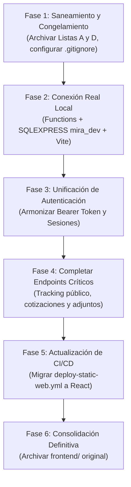

# MIRA — Auditoría Integral de Consolidación del Sistema Real

**Fecha:** 5 de noviembre de 2026  
**Versión del Proyecto:** MIRA 2.0 (Fase de Consolidación Real)  
**Autor:** Antigravity (Auditoría Técnica de Arquitectura y Seguridad)  
**Objetivo:** Diagnóstico exhaustivo del repositorio, clasificación de archivos, inventario de contratos frontend/backend, compatibilidad de lógica de negocio y plan de transición hacia el entorno local real (`frontend-react` → Azure Functions → SQL Server Express `mira_dev`).

---

## 1. Diagnóstico General del Proyecto

### 1.1 Contexto Ejecutivo
El **Sistema MIRA** es una plataforma tipo CRM concebida para la prospección, cotización, asignación técnica y seguimiento operativo de servicios de mantenimiento industrial especializado (limpieza de silos, desengrase industrial, pintura epóxica, mantenimiento de cubiertas, entre otros).

A lo largo de las fases de desarrollo recientes, el proyecto experimentó una aceleración orientada a validar la experiencia de usuario y la fidelidad estética de sus paneles administrativos, operativos y públicos. Este enfoque impulsó la creación de un robusto **Modo Demostración (`demoMode`)**, el cual permitió simular flujos de trabajo sin requerir una conexión activa a Azure SQL Database ni comprometer datos productivos.

Sin embargo, esta fase de prototipado generó una bifurcación estructural:
1. **Doble Frontend:** Coexisten la carpeta histórica `frontend/` (sitio estático en HTML5, CSS y JavaScript Vanilla) y la carpeta moderna `frontend-react/` (Single Page Application desarrollada en React 19, TypeScript, Vite y Tailwind CSS).
2. **Backend en Azure Functions:** Un backend monolítico implementado en `backend/function_app.py` (~1,200 líneas de Python 3.12 con el modelo de programación Azure Functions v2) que soporta 15 endpoints HTTP.
3. **Persistencia Dual y Desfase de Esquemas:** La base de datos local `mira_dev` (en SQL Server Express local) cuenta con migraciones aplicadas de la fase inicial (tablas `mira.Users`, `mira.Roles`, `mira.Requests`, `mira.WorkNotes`, `mira.StatusHistory`, `mira.EmailVerificationTokens` y `mira.UserSessions`). No obstante, las migraciones correspondientes a `mira.Quotations`, `mira.Attachments` y `mira.ServiceOrders` existen como scripts SQL pero no han sido expuestas a través de endpoints en el backend.
4. **Acumulación de Residuos Operativos:** Existen en la raíz del repositorio archivos de base de datos Azurite (`__azurite_db_*`), copias de respaldo de archivos del backend (`function_app.py.bak_*`), parches git sueltos, una carpeta `scratch/` con más de 50 scripts y capturas de prueba, y una carpeta fantasma `node_modules/` en la raíz (generada por ejecuciones accidentales sin un `package.json` raíz).

### 1.2 Estado de Salud del Código
* **Frontend React (`frontend-react/`):** Excelente salud técnica estática. Cuenta con 79 pruebas unitarias e integradas pasando al 100% en Vitest (`8/8` suites exitosas) y compila sin advertencias tanto en modo producción (`npm run build`) como en modo demostración (`npm run build:demo`).
* **Seguridad y Modo Real:** La capa de abstracción `src/api/client.ts` está debidamente aislada. En modo real (`isDemoMode() === false`), las peticiones HTTP se emiten directamente mediante `fetch()` y los fallos de red o de API arrojan errores explícitos, garantizando que el sistema jamás sustituya silenciosamente una falla real por datos simulados.
* **Riesgo Crítico Detectado:** El archivo de configuración `backend/local.settings.json` actualmente contiene la cadena de conexión que apunta a **Azure SQL Database** (`database.windows.net`). Cualquier intento de ejecutar `func start` directamente desde la carpeta `backend/` sin sustituir esta configuración pondría en riesgo la base de datos de producción o fallaría por restricciones de red. Para el trabajo local se debe utilizar estrictamente `backend/local.settings.dev.json` (que apunta a `.\SQLEXPRESS` con la base `mira_dev`).

---

## 2. Inventario General de Archivos y Clasificación

A continuación se presenta el inventario exhaustivo del repositorio, clasificado de acuerdo con los criterios solicitados:
* **CONSERVAR:** Componente esencial para el funcionamiento, compilación, pruebas o documentación del sistema real.
* **REFACTORIZAR:** Componente activo que requiere ajustes de integración, corrección de endpoints o desacoplamiento.
* **ARCHIVAR:** Código de valor histórico o de respaldo que debe moverse a un directorio de archivo antes de su retiro.
* **CANDIDATO A ELIMINAR:** Archivo temporal, residuo de compilación, backup obsoleto o fantasma sin referencias.
* **REQUIERE INVESTIGACIÓN:** Archivo cuya eliminación podría impactar flujos de trabajo de infraestructura o CI/CD.

| Archivo o Carpeta | Función | Dependencias | Estado | Recomendación | Riesgo de Eliminar |
| :--- | :--- | :--- | :--- | :--- | :--- |
| `frontend-react/` | SPA oficial en React 19, TypeScript, Vite y Tailwind CSS con todos los portales y cotizador | Node 20+, npm, Vite, Vitest | Activo y validado | **CONSERVAR** | **CRÍTICO.** Destruiría la interfaz oficial del sistema. |
| `frontend/` | Sitio original estático (HTML, CSS, JS vanilla) | Ninguna (archivos estáticos) | Histórico | **ARCHIVAR** | **ALTO.** El workflow `.github/workflows/deploy-static-web.yml` aún apunta a esta carpeta. No eliminar hasta actualizar CI/CD. |
| `backend/function_app.py` | API principal Azure Functions v2 (15 endpoints de auth, solicitudes, notas y usuarios) | Python 3.12, pyodbc, azure-functions, pydantic, bcrypt | Activo | **REFACTORIZAR** | **CRÍTICO.** Es el único backend del sistema. Se recomienda modularizarlo en blueprints. |
| `backend/requirements.txt` | Dependencias de Python para el backend | pip | Activo | **CONSERVAR** | **ALTO.** Impediría el despliegue y la ejecución local de Azure Functions. |
| `backend/host.json` | Configuración del runtime de Azure Functions | Azure Functions Host | Activo | **CONSERVAR** | **ALTO.** Rompe el runtime de Functions. |
| `backend/local.settings.dev.json` | Configuración segura para desarrollo local (`.\SQLEXPRESS` / `mira_dev`) | SQL Server Express local | Activo | **CONSERVAR** | **MEDIO.** Es la plantilla segura que evita conexiones accidentales a Azure SQL. |
| `backend/local.settings.json` | Configuración actual de Functions (apunta a Azure SQL) | Azure SQL | Activo | **REFACTORIZAR** | **CRÍTICO.** Contiene secretos y credenciales de Azure. Debe sustituirse localmente con la versión dev sin versionarse en git. |
| `backend/local.settings.example.json` | Ejemplo público de configuración | Ninguna | Activo | **CONSERVAR** | **BAJO.** Documentación de configuración para desarrolladores. |
| `backend/.venv312/` | Entorno virtual de Python 3.12.10 con dependencias instaladas | Python 3.12 | Activo | **CONSERVAR** | **BAJO.** Se puede regenerar con `pip install -r requirements.txt`. |
| `backend/.venv/` | Entorno virtual obsoleto de Python 3.10 | Python 3.10 | Inactivo / Obsoleto | **CANDIDATO A ELIMINAR** | **NULO.** Fue sustituido por `.venv312` al migrar a Python 3.12. |
| `backend/function_app.py.bak_*` (4 archivos) | Respaldos manuales de la Fase 18 (`bak_fase18a`, `b`, `c`, `d1`) | Ninguna | Residuos | **CANDIDATO A ELIMINAR** | **NULO.** Los cambios ya están preservados en el historial de Git. |
| `database/001_create_schema.sql` a `009_create_user_sessions.sql` | Migraciones SQL canónicas del esquema `mira` | SQL Server | Activo | **CONSERVAR** | **CRÍTICO.** Define el esquema maestro de base de datos. |
| `database/local-dev/` | Scripts de aprovisionamiento y verificación automática para `mira_dev` (`deploy_local_db.py`, `verify_local_db.py`) | Python, pyodbc, SQL Server Express | Activo | **CONSERVAR** | **MEDIO.** Herramienta esencial para validar el entorno local sin tocar Azure. |
| `database/migrations/` | Directorio con copia duplicada de `008_expand_password_hash.sql` | Ninguna | Redundante | **CANDIDATO A ELIMINAR** | **NULO.** La migración canónica reside en `database/008_expand_password_hash.sql`. |
| `tests/` | Suites de pruebas E2E y seguridad en Python y Node (`browser_e2e_validation.mjs`, `security_idor_test.py`, `test_secure_sessions.py`) | Playwright, Pytest, Requests | Activo | **CONSERVAR** | **MEDIO.** Validan seguridad IDOR, sesiones y flujos completos. |
| `scripts/start-local-demo.ps1` y `stop-local-demo.ps1` | Automatización de arranque del stack local completo | PowerShell, Azurite, func, vite | Activo | **REFACTORIZAR** | **MEDIO.** Deben ajustarse para alternar limpiamente entre modo demo y modo real local. |
| `docs/GUIA_GITHUB_AZURE.md` | Guía técnica de arquitectura y despliegue en Azure | Markdown | Activo | **CONSERVAR** | **NULO.** Documentación de infraestructura. |
| `docs/after_restoration/`, `before_restoration/`, `comparisons/`, `reference_images/`, `reference_inspection/`, `screenshots_demo/` | Evidencias visuales y capturas históricas de diseño | Ninguna | Histórico | **ARCHIVAR** | **NULO.** No afectan ejecución ni compilación. |
| `.github/workflows/deploy-functions.yml` | Pipeline de CI/CD para Azure Functions | GitHub Actions | Activo | **CONSERVAR** | **ALTO.** Automatiza el despliegue de Functions en Azure. |
| `.github/workflows/deploy-static-web.yml` | Pipeline de CI/CD para Azure Static Web Apps (apunta a `frontend/`) | GitHub Actions | Desactualizado | **REFACTORIZAR** | **CRÍTICO.** Despliega la web pública. Si se elimina o falla, interrumpe el sitio en producción. Debe migrarse a `frontend-react`. |
| `node_modules/` (en raíz) | Carpeta fantasma con `.vite` y `.vitest-cache`, sin `package.json` raíz | Ninguna | Huérfano | **CANDIDATO A ELIMINAR** | **NULO.** Fue creada por accidente al ejecutar herramientas desde la raíz en lugar de `frontend-react/`. |
| `__azurite_db_*`, `AzuriteConfig`, `__blobstorage__`, `__queuestorage__` (en raíz y backend) | Archivos de emulación de almacenamiento Azurite generados durante pruebas | Azurite | Temporal | **CANDIDATO A ELIMINAR** | **NULO.** Son artefactos temporales de emulación local. Deben confinarse a una subcarpeta ignorada por `.gitignore`. |
| `respaldo_antes_de_recuperar_diseno.patch` y `respaldo_antes_de_recuperar_index.patch` | Parches de código generados durante la fase de restauración | Ninguna | Residuos | **CANDIDATO A ELIMINAR** | **NULO.** Cambios ya absorbidos en la rama `main`. |
| `scratch/` | Scripts de captura Playwright, auditorías temporales y respaldos de prueba (~52 archivos) | Node, Python | Temporales | **ARCHIVAR** | **NULO.** Directorio de trabajo temporal. Ningún componente de producción depende de él. |

---

## 3. Comparación Detallada: Frontend Original (`frontend/`) vs Moderno (`frontend-react/`)

### 3.1 Matriz de Cobertura Funcional y Visual

| Característica / Vista | `frontend/` (HTML/JS Original) | `frontend-react/` (React Moderno) | Estado de Migración | Evaluación Técnica |
| :--- | :--- | :--- | :--- | :--- |
| **Sitio Público y Landing** | `index.html` monolítico de 50 KB con estilos en cascada CSS. | `HomePage.tsx` modularizado en 15 componentes desacoplados (`HeroSection`, `ServicesSection`, `TrustRibbon`, etc.). | **100% Migrado y Superado** | La versión en React incluye animaciones pulidas, tipografía corporativa y diseño fiel. |
| **Cotizador Multi-Paso** | Formulario en `index.html` con scripts en `app.js`. | `QuoteWizard.tsx` con 4 pasos interactivos, validaciones reactivas de esquemas y catálogo estructurado. | **100% Migrado y Superado** | React maneja estado dinámico por paso, catálogo con búsqueda en tiempo real y selector geográfico de México. |
| **Seguimiento Público por Folio** | Modal básico en JavaScript. | `TrackingModal.tsx` con consulta por folio, badges de estado y diseño accesible. | **Migrado (UI lista)** | UI completa; requiere en backend un endpoint público de solo lectura por folio. |
| **Autenticación y Registro** | `login.html` y `register.html` con validaciones básicas en `login.js`. | `LoginPage.tsx` y `RegisterPage.tsx` integrados con `AuthContext.tsx`, soporte para OTP y sesión persistente. | **100% Migrado y Superado** | Incluye modal para verificación de correo (`VerifyOtpModal.tsx`) y roles tipados. |
| **Portal Cliente** | `cliente.html` (67 KB) con scripts en `cliente.js`. | `ClientDashboardPage.tsx` con navegación lateral, resumen ejecutivo, listado de solicitudes, perfil y vinculación. | **100% Migrado y Superado** | Se eliminó código duplicado y se integró con `claimRequests` para clientes nuevos. |
| **Portal Operador** | `operador.html` (64 KB) con scripts en `operador.js`. | `OperatorDashboardPage.tsx` con bitácora de notas, actualización de estado autorizada y filtros de asignación. | **100% Migrado y Superado** | Filtra automáticamente solicitudes ajenas y previene colisiones de estado. |
| **Portal Administrador** | `admin.html` (30 KB) con scripts en `admin.js`. | `AdminDashboardPage.tsx` con Dashboard Ejecutivo dinámico (KPIs, gráficas SVG, tendencia, actividad reciente). | **100% Migrado y Superado** | Supera ampliamente al frontend original; calcula métricas reales de servicios industriales y elimina datos estáticos. |
| **Expediente de Cotización** | Formulario plano en `admin.html`. | `AdminQuoteDetailPage.tsx` con diseño fiel a prototipo aprobado, 2 columnas, inmutabilidad de datos de cliente y apertura en nueva pestaña. | **100% Migrado y Superado** | Implementa con precisión la distribución de 3 filas x 2 columnas requerida por el negocio. |

### 3.2 Declaración Oficial del Frontend
> [!IMPORTANT]
> **DECLARACIÓN ARQUITECTÓNICA:**  
> Se declara formal y definitivamente a **`frontend-react/`** como el **Frontend Oficial y Único** del Sistema MIRA.
>
> La carpeta original `frontend/` se clasifica como **Respaldo Histórico Temporal** y **NO debe eliminarse de inmediato** debido a una dependencia crítica de infraestructura en CI/CD.

### 3.3 Dependencia Crítica de Despliegue en GitHub Actions
Al auditar el archivo [`.github/workflows/deploy-static-web.yml`](file:///c:/Users/Dell/Desktop/mira_2026/.github/workflows/deploy-static-web.yml#L1-L18):
```yaml
name: Deploy Static Web App
on:
  push:
    branches: [main]
    paths: ["frontend/**", ".github/workflows/deploy-static-web.yml"]
jobs:
  deploy:
    runs-on: ubuntu-latest
    steps:
      - uses: actions/checkout@v4
      - uses: Azure/static-web-apps-deploy@v1
        with:
          azure_static_web_apps_api_token: ${{ secrets.AZURE_STATIC_WEB_APPS_API_TOKEN }}
          action: upload
          app_location: frontend
          output_location: ""
          skip_app_build: true
```
**Hallazgo:** El flujo de CI/CD está configurado para desplegar el contenido de la carpeta `frontend/` sin ejecutar ningún proceso de construcción (`skip_app_build: true`). Si en este momento se eliminara o renombrara `frontend/`, el despliegue automático fallaría.

**Solución requerida en la fase de transición:**
Actualizar `deploy-static-web.yml` para compilar `frontend-react`:
```yaml
app_location: "frontend-react"
api_location: ""
output_location: "dist"
app_build_command: "npm run build"
```
Una vez verificada la ejecución de este workflow con éxito en Azure Static Web Apps, la carpeta `frontend/` podrá ser archivada o eliminada de manera 100% segura.

---

## 4. Estructura Definitiva Recomendada para MIRA

Para simplificar el mantenimiento, eliminar la ambigüedad de doble frontend y mantener un repositorio limpio y profesional, se recomienda consolidar el proyecto en la siguiente estructura canónica:

```
mira_2026/
├── .github/
│   └── workflows/
│       ├── deploy-functions.yml          # CI/CD para Azure Functions (Python 3.12)
│       └── deploy-static-web.yml        # CI/CD para SPA React (compila dist/)
├── backend/
│   ├── function_app.py                  # API Azure Functions (o modularizada en blueprints)
│   ├── host.json                        # Configuración del runtime de Functions
│   ├── requirements.txt                 # Dependencias Python
│   ├── local.settings.dev.json          # Configuración plantilla para mira_dev local
│   ├── local.settings.example.json      # Ejemplo público sin credenciales
│   └── .venv312/                        # Entorno virtual local (ignorado en git)
├── database/
│   ├── 001_create_schema.sql            # Migraciones canónicas ordenadas (001 a 009)
│   ├── ...
│   ├── 009_create_user_sessions.sql
│   └── local-dev/                       # Herramientas de despliegue y verificación local
│       ├── deploy_local_db.py           # Aplica migraciones a .\SQLEXPRESS (mira_dev)
│       └── verify_local_db.py           # Audita integridad de tablas, FKs y roles
├── docs/                                # Documentación técnica y arquitectura
│   ├── AUDITORIA_CONSOLIDACION_MIRA.md  # Presente informe de auditoría
│   └── GUIA_GITHUB_AZURE.md             # Guía de infraestructura Azure
├── frontend-react/                      # Frontend oficial (en fase final puede renombrarse a frontend/)
│   ├── public/                          # Activos estáticos públicos (logos, galería, favicon)
│   ├── src/                             # Código fuente TypeScript + React
│   │   ├── api/                         # Clientes HTTP y tipos de comunicación
│   │   ├── components/                  # Componentes reutilizables y layout
│   │   ├── context/                     # Contextos globales (AuthContext)
│   │   ├── data/                        # Catálogo de servicios y ubicaciones
│   │   ├── pages/                       # Vistas por perfil (admin, client, operator, public)
│   │   ├── routes/                      # Definición de rutas y guardas protegidas
│   │   ├── styles/                      # Tokens y estilos globales
│   │   ├── tests/                       # Pruebas unitarias e integradas (Vitest)
│   │   └── types/                       # Interfaces TypeScript unificadas
│   ├── package.json
│   ├── vite.config.ts
│   └── tsconfig.json
├── scripts/                             # Utilidades de desarrollo local
│   ├── start-local-stack.ps1            # Inicia Azurite + Functions + Vite coordinadamente
│   └── stop-local-stack.ps1             # Detiene los procesos locales de desarrollo
├── tests/                               # Pruebas E2E de sistema y seguridad
│   ├── browser_e2e_validation.mjs
│   ├── security_idor_test.py
│   └── test_secure_sessions.py
├── .gitignore                           # Excluye node_modules, .venv, *.bak, Azurite, local.settings.json
└── README.md                            # Documentación general de bienvenida al proyecto
```

---

## 5. Auditoría del Modo Demostración vs. Modo Real

### 5.1 Mecanismo de Activación y Prioridad
El modo demostración se gobierna centralizadamente a través de la función `isDemoMode()` en [`frontend-react/src/utils/demoMode.ts`](file:///c:/Users/Dell/Desktop/mira_2026/frontend-react/src/utils/demoMode.ts#L1-L25). El orden estricto de resolución es:

$$\text{isDemoMode} = (\text{VITE\_DEMO\_MODE} = \text{'true'}) \lor (\text{URL tiene } ?\text{demo=true}) \lor (\text{pathname inicia con } /\text{demo}) \lor (\text{localStorage.mira\_demo\_mode} = \text{'true'})$$

### 5.2 Capa de Aislamiento en el Cliente de Red
En [`frontend-react/src/api/client.ts`](file:///c:/Users/Dell/Desktop/mira_2026/frontend-react/src/api/client.ts#L35-L95):
* Si `isDemoMode()` es **verdadero**: la llamada es interceptada por `handleMockRequest(endpoint, options)` en [`src/api/mockHandler.ts`](file:///c:/Users/Dell/Desktop/mira_2026/frontend-react/src/api/mockHandler.ts#L1-L150) y responde utilizando el repositorio en memoria [`src/data/mockDemoData.ts`](file:///c:/Users/Dell/Desktop/mira_2026/frontend-react/src/data/mockDemoData.ts#L1-L200).
* Si `isDemoMode()` es **falso**: el interceptor se omite por completo; la petición se envía mediante la función estándar `fetch()` hacia `/api/...` adjuntando el encabezado `Authorization: Bearer <mira_token>`.

### 5.3 Verificación de Seguridad en Fallos de Red
> [!IMPORTANT]
> **REGLA DE NO-DEGRADACIÓN SILENCIOSA CUMPLIDA:**  
> Se auditó el bloque `try/catch` de `client.ts`:
> ```typescript
> const response = await fetch(url, fetchOptions);
> if (!response.ok) {
>   const errorBody = await response.json().catch(() => ({}));
>   throw new Error(errorBody.error || `Error HTTP ${response.status}: ${response.statusText}`);
> }
> ```
> Si la API de Azure Functions o la base de datos local `mira_dev` devuelve un error (p. ej. `500 Internal Server Error` o `503 Service Unavailable`) o hay un fallo de conexión, el cliente **lanza la excepción inmediatamente**. En ningún caso se realiza un "fallback" a datos simulados cuando se está operando en modo real.

### 5.4 Elementos Visuales del Modo Demo a Segregar
1. **Banner de Demostración (`DemoBanner.tsx`):** Solo se renderiza si `isDemoMode()` es verdadero.
2. **Selector Rápido de Roles en Cabecera (`Header.tsx`):** Permite cambiar instantáneamente entre `Cliente`, `Operador` y `Admin`. En la versión de producción real debe asegurarse que estos conmutadores permanezcan ocultos cuando `isDemoMode() === false`, permitiendo el acceso exclusivamente mediante la autenticación formal del usuario.

---

## 6. Estado y Auditoría de los Tres Perfiles de Usuario

### 6.1 Perfil: CLIENTE (`Role: CLIENT`)
* **Registro e Inicio de Sesión:** Conectado a `/api/auth/register` y `/api/auth/login`. Requiere contraseña y genera registro en `mira.Users`.
* **Verificación de Correo (OTP):** Conectado a `/api/auth/request-email-verification` y `/api/auth/verify-email`. Muestra el modal `VerifyOtpModal.tsx` si `email_verified === false`.
* **Vinculación de Solicitudes Previas (`claimRequests`):** Conectado a `/api/requests/claim`. Permite que un cliente que solicitó una cotización de forma anónima vincule el folio a su cuenta recién creada comprobando su correo electrónico.
* **Consulta de Solicitudes Propias:** Conectado a `/api/requests` (el backend filtra automáticamente `WHERE ClientId = @UserId` si el rol es `CLIENT`).
* **Botones Inactivos / Vistas Decorativas:**
  - `DocumentsView.tsx`: Actualmente es una vista informativa ("Próximamente disponible") con tarjetas de ejemplo de cotizaciones descargables.
  - Botón "Descargar PDF de cotización": No tiene endpoint de generación de PDF en el backend.

### 6.2 Perfil: OPERADOR (`Role: OPERATOR`)
* **Listado de Solicitudes Asignadas:** Conectado a `/api/requests`. El backend aplica la restricción de seguridad:
  ```sql
  WHERE AssignedToUserId = @CurrentUserId
  ```
  Un operador no puede consultar solicitudes asignadas a otros técnicos ni solicitudes libres sin asignar.
* **Cambio de Estatus Operativo:** Conectado a `PATCH /api/requests/{id}/status`. Permite transicionar solicitudes entre `A` (Atendida) y `T` (Terminada).
* **Registro en Bitácora Técnica:** Conectado a `POST /api/requests/{id}/notes`. Registra notas visibles para el equipo y el cliente en `mira.WorkNotes`.
* **Botones Inactivos / Restricciones:**
  - El operador no puede reasignar solicitudes (el selector de operador está bloqueado para su rol).

### 6.3 Perfil: ADMINISTRADOR (`Role: ADMIN`)
* **Dashboard Ejecutivo (`AdminSummaryView.tsx`):**
  - **Dinámico:** Las cifras de "Total de cotizaciones", "Nuevas", "En revisión", "Asignadas", "Cotizadas", "Aprobadas" y "Canceladas" se computan en tiempo real a partir del array de solicitudes cargadas de la API.
  - **Gráfica de Tendencia y Distribución por Estado:** Genera SVG vectoriales basados en fechas y estados reales.
  - **Servicios más Solicitados:** Agrupa y totaliza dinámicamente según la categoría industrial solicitada.
* **Gestión de Solicitudes (`AdminRequestsView.tsx` y `QuoteTableView.tsx`):**
  - Permite filtrar por texto, estado, urgencia y fecha.
  - Abre el expediente en una pestaña nueva del navegador (`target="_blank"` hacia `/admin/cotizaciones/:id`).
* **Expediente de Cotización (`AdminQuoteDetailPage.tsx` y `QuoteDetailView.tsx`):**
  - **Inmutabilidad de Datos del Cliente:** Los datos de contacto y la descripción original del cliente son de solo lectura, protegiendo la solicitud original.
  - **Asignación de Operador:** Conectado a `PATCH /api/requests/{id}/assign`. Actualiza `AssignedToUserId` en la base de datos.
  - **Cambio de Estado:** Conectado a `PATCH /api/requests/{id}/status`. Actualiza el estado y registra el evento en `mira.StatusHistory`.
  - **Bitácora y Notas:** Conectado a `GET /api/requests/{id}/notes` y `POST /api/requests/{id}/notes`.
* **Botones Inactivos / Pantallas Decorativas en Administrador:**
  - **Botón "Adjuntos" en Expediente:** Abre un modal informativo; el backend aún no tiene implementado el endpoint para subir o listar blobs de adjuntos vinculados a `mira.Attachments`.
  - **Botón "Enviar cotización" en Expediente:** En modo real muestra un mensaje advirtiendo que el módulo de emisión económica formal está en preparación; no existe el endpoint en `function_app.py`.
  - **Secciones `AdminClientsView.tsx` y `AdminReportsView.tsx`:** Vistas que muestran estados de resumen pero no cuentan con endpoints dedicados en el backend más allá de la lista de usuarios.

---

## 7. Matriz de Contratos Frontend / Backend (15 Endpoints de `backend/function_app.py`)

| # | Funcionalidad | Componente React Consumidor | Endpoint en Backend | Método | Permisos (Rol) | Payload / Parámetros Enviados | Respuesta / Esquema Devuelto | Clasificación de Integración |
| :---: | :--- | :--- | :--- | :---: | :---: | :--- | :--- | :--- |
| **1** | Registro de usuario | `RegisterPage.tsx` | `/api/auth/register` | `POST` | Público | `{ email, password, full_name, phone?, company? }` | `{ success: true, user: { id, email, role, ... } }` | **FUNCIONAL CON API** |
| **2** | Inicio de sesión | `LoginPage.tsx` | `/api/auth/login` | `POST` | Público | `{ email, password }` | `{ token, user: { id, email, role, ... } }` (+ cookies) | **FUNCIONAL CON API** |
| **3** | Datos de sesión actual | `AuthContext.tsx` | `/api/auth/me` | `GET` | Autenticado | Header `Authorization: Bearer <token>` | `{ user: { id, email, role, email_verified, ... } }` | **FUNCIONAL CON API** |
| **4** | Cierre de sesión | `Header.tsx`, Sidebars | `/api/auth/logout` | `POST` | Autenticado | Vacío (revoca sesión activa) | `{ success: true }` | **FUNCIONAL CON API** |
| **5** | Renovación de token | `client.ts` | `/api/auth/refresh` | `POST` | Autenticado | Cookie de refresh o token expirado | `{ token, user }` | **FUNCIONAL CON API** |
| **6** | Solicitar código OTP | `VerifyOtpModal.tsx` | `/api/auth/request-email-verification` | `POST` | Autenticado | Vacío (usa identidad de sesión) | `{ success: true, message: "Código enviado" }` | **FUNCIONAL CON API** |
| **7** | Verificar código OTP | `VerifyOtpModal.tsx` | `/api/auth/verify-email` | `POST` | Autenticado | `{ code: "123456" }` | `{ success: true, email_verified: true }` | **FUNCIONAL CON API** |
| **8** | Diagnóstico de salud | `HealthCheck` / Tests | `/api/health` | `GET` | Público | Ninguno | `{ status: "ok", timestamp, db: "connected" }` | **FUNCIONAL CON API** |
| **9** | Enviar cotización | `QuoteWizard.tsx` | `/api/requests` | `POST` | Público / Autenticado | `{ space_type, services[], state, city, name, email, phone, notes }` | `{ request_id, folio: "SOL-2026-...", status: "E" }` | **FUNCIONAL CON API** |
| **10** | Listar solicitudes | `AdminRequestsView`, `RequestsView` | `/api/requests` | `GET` | Autenticado (`CLIENT`, `OPERATOR`, `ADMIN`) | Filtros query opcionales: `?status=...&search=...` | `[ { id, folio, service_type, status, client_name, ... } ]` | **FUNCIONAL CON API** |
| **11** | Vinculación de folios | `ClientDashboardPage` | `/api/requests/claim` | `POST` | Autenticado (`CLIENT`) | Vacío (busca por email del usuario) | `{ claimed_count: number, request_ids: number[] }` | **FUNCIONAL CON API** |
| **12** | Asignar operador | `OperatorAssignSelector` | `/api/requests/{id}/assign` | `PATCH` | `ADMIN` | `{ assigned_to_user_id: number }` | `{ success: true, request_id, assigned_to_user_id }` | **FUNCIONAL CON API** |
| **13** | Cambiar estado | `StatusUpdateSelector` | `/api/requests/{id}/status` | `PATCH` | `OPERATOR`, `ADMIN` | `{ status: "E"|"A"|"T"|"C", comment?: string }` | `{ success: true, request_id, new_status }` | **FUNCIONAL CON API** |
| **14** | Bitácora de notas | `WorkNotesSection`, `QuoteDetailView` | `/api/requests/{id}/notes` | `GET` / `POST` | Autenticado | POST: `{ note: string, is_internal?: boolean }` | GET: `[ { id, note, created_at, author_name, ... } ]` | **FUNCIONAL CON API** |
| **15** | Lista de usuarios | `AdminUsersView` | `/api/users` | `GET` / `POST` | `ADMIN` | POST: `{ email, password, full_name, role_id }` | GET: `[ { id, email, full_name, role, is_active } ]` | **FUNCIONAL CON API** |
| **--** | Consulta pública de folio | `TrackingModal.tsx` | `/api/requests/track/{folio}` | `GET` | Público | Folio oficial en URL | *No existe endpoint específico* (requiere `GET /api/requests` sin token) | **SIN BACKEND (Solo en Demo)** |
| **--** | Subida de archivos adjuntos | `QuoteDetailView` (Modal) | `/api/requests/{id}/attachments` | `POST` | Autenticado | Form-data con archivo binario | *No existe endpoint en function_app.py* | **SIN BACKEND** |
| **--** | Emisión formal de cotización | `QuoteDetailView` (Enviar) | `/api/quotations` | `POST` | `ADMIN` | `{ request_id, subtotal, iva, total, valid_until, items[] }` | *No existe endpoint en function_app.py* | **SIN BACKEND** |

### 7.1 Auditoría del Esquema de Autenticación
Durante la Fase 18 se introdujo en el backend una capa de **seguridad dual** para autenticación:
1. **Encabezado Bearer Token (`Authorization: Bearer <token>`):** Utilizado por el cliente SPA de React almacenando el token en `localStorage.getItem('mira_token')`.
2. **Cookies de Sesión HttpOnly (`mira_session`, `mira_refresh`, `mira_csrf`):** Registradas en la tabla `mira.UserSessions` para mitigar ataques XSS.
* **Diagnóstico:** El backend acepta satisfactoriamente ambas modalidades. Sin embargo, para entornos locales con Vite en el puerto `5173` y Azure Functions en el puerto `7071`, el uso de cookies HttpOnly entre orígenes distintos exige una configuración estricta del proxy de Vite para que las cookies fluyan sin ser rechazadas por la directiva SameSite del navegador. El encabezado Bearer funciona de forma transparente a través del proxy de desarrollo.

---

## 8. Inconsistencias de Lógica de Negocio y Estados de Solicitud

### 8.1 Los Estados Nativos en la Base de Datos (`mira.Requests`)
En el esquema de SQL Server (`001_create_schema.sql` y `003_extend_requests.sql`), la columna `mira.Requests.Status` está restringida mediante un check constraint a exactamente cuatro valores:
* **`E` (Enviada):** La solicitud fue creada por el cliente y recibida por MIRA. Está pendiente de revisión.
* **`A` (Atendida):** La solicitud fue tomada por el equipo operativo/comercial, se encuentra en revisión o en proceso de ejecución.
* **`T` (Terminada):** Los trabajos técnicos u operativos han sido completados en su totalidad.
* **`C` (Cancelada):** La solicitud fue anulada por el cliente o descartada por inviabilidad.

### 8.2 Inconsistencia Detectada en la Maqueta Visual
En las maquetas visuales del panel administrativo aprobadas para el modo demostración se utilizaron etiquetas de estado adicionales:
- *"Nuevas / Recibidas"* (mapeada a `E`)
- *"En revisión"* (mapeada a `A`)
- *"Asignadas"* (solicitudes con `AssignedToUserId IS NOT NULL`)
- *"Cotizadas"* (solicitudes que cuentan con una propuesta económica emitida)
- *"Aprobadas"* (solicitudes cuya cotización fue aceptada comercialmente por el cliente)
- *"Canceladas"* (mapeada a `C`)

> [!WARNING]
> **CONFUSIÓN ENTRE CICLO OPERATIVO Y CICLO COMERCIAL:**  
> En el modo demo, la letra `T` se presentó en algunas interfaces bajo la etiqueta **"Aprobada"**, cuando en el diseño de base de datos original `T` significa **"Terminada"** (conclusión del servicio).
>
> Para evitar inconsistencias al conectar el sistema real:
> 1. No se deben crear nuevos estados artificiales en la columna `mira.Requests.Status`.
> 2. Una solicitud que está "Asignada" se identifica formalmente por: `Status IN ('E', 'A') AND AssignedToUserId IS NOT NULL`.
> 3. Los estados comerciales ("Cotizada", "Aprobada por el cliente", "Rechazada") pertenecen a la tabla **`mira.Quotations`** (creada en la migración `005_create_quotations.sql`), mientras que la ejecución del trabajo pertenece a **`mira.ServiceOrders`** (`006_create_service_orders.sql`).

---

## 9. Propuesta de Depuración Segura

Para sanear el repositorio antes de reactivar el backend real, se clasifican los archivos candidatos a depuración en cinco listas rigurosamente delimitadas.

> [!CAUTION]
> **REGLA DE DIAGNÓSTICO:**  
> Ninguno de estos movimientos ni eliminaciones se ejecutará en esta fase. Se requiere la validación expresa del usuario antes de proceder.

### Lista A: Archivos Seguros para Archivar Inmediatamente
Archivos de respaldo manual y parches que saturan el árbol de trabajo pero cuyo contenido ya está en el historial de Git:
1. `backend/function_app.py.bak_fase18a`
2. `backend/function_app.py.bak_fase18b`
3. `backend/function_app.py.bak_fase18c`
4. `backend/function_app.py.bak_fase18d1`
5. `respaldo_antes_de_recuperar_diseno.patch`
6. `respaldo_antes_de_recuperar_index.patch`

### Lista B: Archivos Redundantes que Requieren Comprobación
Archivos con duplicidad evidente que deben verificarse antes de su retiro:
1. `database/migrations/008_expand_password_hash.sql` (es copia idéntica de `database/008_expand_password_hash.sql`).
2. `scratch/` (contiene 52 scripts de Playwright y volcados temporales; deben empaquetarse en un archivo comprimido o trasladarse a una carpeta de archivo histórica fuera de git).
3. `backend/.venv/` (entorno virtual obsoleto de Python 3.10; verificar que nadie lo use antes de eliminar).

### Lista C: Archivos Obsoletos del Frontend Original (`frontend/`)
Toda la carpeta `frontend/` (`admin.html`, `cliente.html`, `index.html`, `login.html`, `operador.html`, `portal.html`, `register.html`, `js/`, `css/`).
* **Condición de retiro:** Solo se archivará una vez actualizado el archivo `.github/workflows/deploy-static-web.yml` para compilar y servir `frontend-react/dist`.

### Lista D: Archivos Temporales de Runtime
Artefactos autogenerados en la raíz que deben ser eliminados del control de versiones y agregados a `.gitignore`:
1. `node_modules/` en la raíz del repositorio (debe conservarse únicamente `frontend-react/node_modules/`).
2. Archivos Azurite en la raíz y en `backend/`: `__azurite_db_blob__.json`, `__azurite_db_blob_extent__.json`, `__azurite_db_queue__.json`, `__azurite_db_queue_extent__.json`, `__azurite_db_table__.json`, `AzuriteConfig`, carpeta `__blobstorage__/`, carpeta `__queuestorage__/`.
3. `backend/__pycache__/` y archivos `.pyc`.

### Lista E: Archivos Protegidos que NO Deben Eliminarse
* Todos los archivos de `frontend-react/src/`.
* `backend/function_app.py`, `backend/requirements.txt`, `backend/host.json`.
* Todas las migraciones `database/001_*.sql` a `009_*.sql`.
* Herramientas de base de datos en `database/local-dev/`.
* Suites de pruebas en `tests/` y `frontend-react/src/tests/`.
* Workflows de GitHub en `.github/workflows/`.

---

## 10. Análisis de Riesgos de Eliminación por Categoría

1. **Riesgo de Ruptura de Compilación (TypeScript / Vite):**  
   * Si se alteran o eliminan archivos en `frontend-react/src/types/` o componentes compartidos como `OperatorAssignSelector.tsx` o `StatusUpdateSelector.tsx`, las 79 pruebas de Vitest fallarán de inmediato y `npm run build` se interrumpirá.
   * *Mitigación:* Todo cambio en React debe ser validado con `npm test -- --run` y `npm run build`.

2. **Riesgo de Ruptura de Despliegue en Producción (CI/CD):**  
   * Si se elimina `frontend/` sin modificar previamente `.github/workflows/deploy-static-web.yml`, el siguiente push a la rama `main` generará un fallo en GitHub Actions y bloqueará los despliegues de Azure Static Web Apps.
   * *Mitigación:* Modificar y probar primero el workflow de CI/CD para compilar `frontend-react`.

3. **Riesgo de Seguridad y Fuga de Secretos:**  
   * `backend/local.settings.json` contiene la cadena de conexión de Azure SQL. Si este archivo se añade a git por error, se expondrán credenciales de base de datos en la nube.
   * *Mitigación:* Comprobar que `.gitignore` contenga `local.settings.json` y que en local se trabaje con `local.settings.dev.json`.

4. **Riesgo de Corrupción de Datos:**  
   * Ejecutar migraciones destructivas sobre la base de datos `mira_dev` sin respaldo previo podría borrar los usuarios de prueba con roles asignados.
   * *Mitigación:* Utilizar los scripts parametrizados `database/local-dev/verify_local_db.py` antes de cualquier operación.

---

## 11. Plan de Integración y Preparación del Entorno Real Local

### 11.1 Componentes del Stack Real Local
El entorno local MIRA debe operar de forma totalmente aislada de Azure, comunicando:
$$\text{React SPA (Vite :5173)} \xrightarrow{\text{Proxy /api}} \text{Azure Functions Core Tools (:7071)} \xrightarrow{\text{pyodbc}} \text{SQL Server Express (.\SQLEXPRESS - mira\_dev)}$$

### 11.2 Verificación de Requisitos Previos en el Host
* **Python 3.12:** Instalado en `backend/.venv312` (`python 3.12.10`).
* **Azure Functions Core Tools:** Instalado a nivel global (`func v4.14.0`).
* **Azurite Storage Emulator:** Instalado a nivel global (`azurite v3.37.0`).
* **SQL Server Express:** Servicio `MSSQL$SQLEXPRESS` activo y ejecutándose en el equipo.
* **Driver ODBC:** `ODBC Driver 17 for SQL Server` instalado.

### 11.3 Procedimiento de Configuración y Arranque Seguro
1. **Configuración de Functions para Base Local:**
   Verificar que en `backend/` exista la configuración dev sin tocar Azure SQL:
   ```json
   {
     "IsEncrypted": false,
     "Values": {
       "AzureWebJobsStorage": "UseDevelopmentStorage=true",
       "FUNCTIONS_WORKER_RUNTIME": "python",
       "SQLAZURECONNSTR_defaultConnection": "Driver={ODBC Driver 17 for SQL Server};Server=.\\SQLEXPRESS;Database=mira_dev;Trusted_Connection=yes;"
     }
   }
   ```
2. **Auditoría Previa de Base de Datos Local:**
   Ejecutar el script de verificación para garantizar aislamiento:
   ```powershell
   python database/local-dev/verify_local_db.py
   ```
   Debe certificar:
   - Servidor: Host local `\SQLEXPRESS`
   - Motor: Edición 4 (SQL Server Express)
   - Base de datos: `mira_dev`
   - Ausencia total de cadenas `.database.windows.net`.
3. **Inicio de los Servicios de Soporte:**
   - Terminal 1 (Azurite):
     ```powershell
     azurite --silent --location .azurite
     ```
   - Terminal 2 (Azure Functions):
     ```powershell
     cd backend
     .venv312\Scripts\activate
     func start --port 7071
     ```
   - Terminal 3 (Frontend React):
     ```powershell
     cd frontend-react
     npm run dev
     ```
4. **Verificación del Proxy de Vite:**
   En [`frontend-react/vite.config.ts`](file:///c:/Users/Dell/Desktop/mira_2026/frontend-react/vite.config.ts#L23-L32), las llamadas a `/api` ya están configuradas para reescribirse hacia `http://localhost:7071`:
   ```typescript
   server: {
     port: 5173,
     proxy: {
       '/api': {
         target: 'http://localhost:7071',
         changeOrigin: true,
       },
     },
   }
   ```

---

## 12. Plan de Trabajo Estructurado por Fases

Para reactivar el sistema real sin riesgos de regresión, se define el siguiente cronograma ordenado:



### Fase 1: Saneamiento de Archivos y Configuración de Git
* Archivar los archivos de respaldo manual (`function_app.py.bak_*` y parches).
* Eliminar archivos residuales de Azurite en la raíz y confinarlos a `.azurite/`.
* Eliminar la carpeta huérfana `node_modules/` de la raíz del proyecto.
* Actualizar `.gitignore` para prevenir futuras intrusiones de archivos de Azurite o entornos virtuales.

### Fase 2: Configuración del Entorno Real Local
* Activar `local.settings.json` apuntando exclusivamente a `.\SQLEXPRESS` (`mira_dev`).
* Validar el script `verify_local_db.py`.
* Iniciar el stack local coordinado con `scripts/start-local-demo.ps1` adaptado para modo real.
* Ejecutar pruebas de conectividad de los 15 endpoints en `mira_dev`.

### Fase 3: Estandarización de Autenticación y Contratos
* Confirmar el flujo completo de autenticación (Login → Token → AuthContext → Cierre de sesión).
* Desactivar el banner y los selectores de modo demo cuando se ingrese en modo real.
* Comprobar las restricciones de rol (IDOR) entre `CLIENT`, `OPERATOR` y `ADMIN` sobre datos reales en `mira_dev`.

### Fase 4: Implementación de Endpoints Faltantes en Backend
* Agregar endpoint público de consulta por folio: `GET /api/requests/track/{folio}` para alimentar `TrackingModal.tsx`.
* Conectar la generación de cotizaciones con la tabla `mira.Quotations` (migración 005 ya existente).
* Habilitar la subida de documentos a Azure Blob Storage / Azurite para soportar el modal de adjuntos del expediente.

### Fase 5: Actualización del Pipeline de CI/CD
* Modificar `.github/workflows/deploy-static-web.yml` para compilar `frontend-react` y subir el artefacto `dist/`.
* Validar que la compilación automática pase sin errores en los runners de GitHub.

### Fase 6: Retiro Definitivo del Frontend Antiguo
* Archivar la carpeta `frontend/` histórica.
* Renombrar formalmente `frontend-react/` a `frontend/` (opcional o mantener la convención clara).
* Actualizar la documentación final del repositorio.

---
*Fin del Informe de Auditoría Técnica MIRA — Consolidación 2026*

