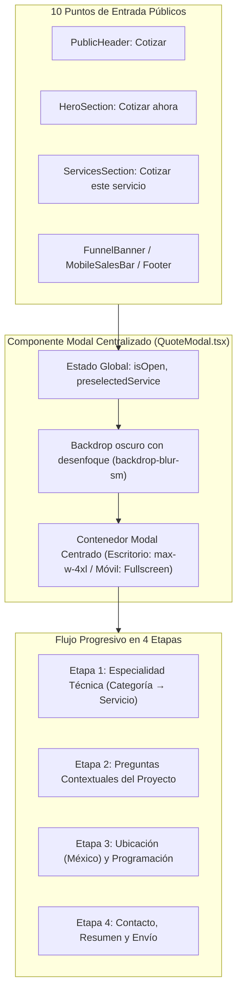

# MIRA — Diagnóstico y Propuesta Técnica: Rediseño UX del Funnel Público de Cotización

**Fecha:** 5 de noviembre de 2026  
**Módulo:** Funnel Público de Cotización y Prospección Comercial  
**Sistema:** React 19 + TypeScript + Vite + Azure Functions (Python 3.12) + SQL Server Express (`mira_dev`)  
**Fase Actual:** Diagnóstico y Propuesta Arquitectónica (Sin modificaciones de código previo a aprobación)

---

## 1. Diagnóstico del Funnel Actual

### 1.1 El Problema del Desplazamiento Vertical (`#cotizar`)
Actualmente, la página principal [`frontend-react/src/pages/public/HomePage.tsx`](file:///c:/Users/Dell/Desktop/mira_2026/frontend-react/src/pages/public/HomePage.tsx) tiene incrustado el formulario de cotización como una sección estática (`<QuoteWizard id="cotizar" />`) ubicada hacia el final de la landing page (después de 11 secciones previas).

Todos los botones de llamada a la acción (CTAs) distribuidos en la página utilizan enlaces con anclas `<a href="#cotizar">` o ejecutan:
```typescript
const quoteEl = document.getElementById('cotizar');
if (quoteEl) {
  quoteEl.scrollIntoView({ behavior: 'smooth' });
}
```

#### Puntos de Fricción Identificados:
1. **Desorientación del Usuario:** El salto o desplazamiento vertical rápido por encima de 11 secciones extensas provoca desorientación visual, especialmente en dispositivos móviles con pantallas táctiles.
2. **Pérdida del Contexto de Navegación:** Si un usuario estaba leyendo sobre un servicio específico en la galería o en el catálogo, al desplazarse bruscamente pierde el hilo del contenido que motivó su interés.
3. **Rigidez en la Experiencia Móvil:** En pantallas pequeñas, el formulario incrustado en el flujo general compite visualmente con el pie de página y la barra fija de ventas (`MobileSalesBar.tsx`).

#### Inventario de CTAs Públicos que Apuntan a `#cotizar`:
Existen actualmente **10 componentes** con botones o enlaces dirigidos al formulario:
1. [`PublicHeader.tsx`](file:///c:/Users/Dell/Desktop/mira_2026/frontend-react/src/pages/public/components/PublicHeader.tsx): Botón principal "Cotizar en línea" (desktop) y botón desplegable móvil.
2. [`HeroSection.tsx`](file:///c:/Users/Dell/Desktop/mira_2026/frontend-react/src/pages/public/components/HeroSection.tsx): Botón principal "Cotizar ahora" en el encabezado visual.
3. [`ValueSection.tsx`](file:///c:/Users/Dell/Desktop/mira_2026/frontend-react/src/pages/public/components/ValueSection.tsx): CTA "Solicitar cotización personalizada".
4. [`ServicesSection.tsx`](file:///c:/Users/Dell/Desktop/mira_2026/frontend-react/src/pages/public/components/ServicesSection.tsx): Botones individuales "Cotizar este servicio" dentro de cada tarjeta técnica.
5. [`CaseStudySection.tsx`](file:///c:/Users/Dell/Desktop/mira_2026/frontend-react/src/pages/public/components/CaseStudySection.tsx): Botón "Cotizar proyecto similar".
6. [`ContactSection.tsx`](file:///c:/Users/Dell/Desktop/mira_2026/frontend-react/src/pages/public/components/ContactSection.tsx): Enlace "Cotizar en línea".
7. [`FunnelBanner.tsx`](file:///c:/Users/Dell/Desktop/mira_2026/frontend-react/src/pages/public/components/FunnelBanner.tsx): Banner intermedio "Solicitar propuesta técnica".
8. [`PublicFooter.tsx`](file:///c:/Users/Dell/Desktop/mira_2026/frontend-react/src/pages/public/components/PublicFooter.tsx): Enlace en columna de servicios y botón final del pie de página.
9. [`MobileSalesBar.tsx`](file:///c:/Users/Dell/Desktop/mira_2026/frontend-react/src/pages/public/components/MobileSalesBar.tsx): Barra de contacto fija inferior en móviles ("Cotizar →").
10. [`ChatBotWidget.tsx`](file:///c:/Users/Dell/Desktop/mira_2026/frontend-react/src/pages/public/components/ChatBotWidget.tsx): Opción automatizada de cotización dentro de la ventana de chat.

---

### 1.2 Análisis de Fricción en los 4 Pasos Actuales

#### Paso 1: Tipo de Espacio ([`Step1SpaceType.tsx`](file:///c:/Users/Dell/Desktop/mira_2026/frontend-react/src/pages/public/components/quote/Step1SpaceType.tsx))
* **Problema:** Muestra 4 opciones (Hotel, Residencial, Empresa, Otro) con botones de selección de radio.
* **Fricción:** Al seleccionar una opción con un clic, el usuario está obligado a mover el cursor hacia la esquina inferior derecha y hacer clic en un botón secundario *"Continuar a Servicios →"*. Al tratarse de una decisión de opción única, este paso adicional es redundante y frena el flujo.

#### Paso 2: Selección de Servicios ([`Step2Services.tsx`](file:///c:/Users/Dell/Desktop/mira_2026/frontend-react/src/pages/public/components/quote/Step2Services.tsx))
* **Problema:** Despliega simultáneamente una barra de búsqueda, 6 botones de filtro por categoría (`Todos`, `Industrial`, `Construcción`, `Comercial`, `Residencial`, `Sanidad`) y una cuadrícula con **15 tarjetas** de servicios.
* **Sobrecarga Cognitiva:** El usuario se encuentra con demasiadas opciones técnicas al mismo tiempo. No hay jerarquía progresiva.
* **Inconsistencias Semánticas en el Catálogo:**
  - Si en el Paso 1 el cliente ya indicó que su espacio es un Hotel, en el Paso 2 vuelve a aparecer un servicio denominado *"Servicios para hoteles"* (`HOTEL_SERV`).
  - Si indicó que es un Condominio, vuelve a aparecer *"Servicios residenciales"* (`RESID_SERV`).
  - Existen duplicidades conceptuales entre *"Pintura profesional y epóxicos"* (`PAINTING`) y *"Recubrimientos epóxicos FDA"* (`EPOXY_COAT`).

#### Paso 3: Ubicación y Detalles ([`Step3ProjectDetails.tsx`](file:///c:/Users/Dell/Desktop/mira_2026/frontend-react/src/pages/public/components/quote/Step3ProjectDetails.tsx))
* **Problema:** Es un formulario genérico estático que solicita Estado, Municipio, Dirección, Fecha estimada y una caja de texto abierta para "Descripción técnica del proyecto".
* **Falta de Contexto:** Un cliente que requiere **Limpieza de Silos** necesita especificar el tipo de grano o residuo, la altura y la cantidad de silos; mientras que un cliente de **Pisos Epóxicos** necesita indicar el metraje y las condiciones del piso. El formulario actual les pide a ambos un texto libre sin guiar las preguntas críticas para el presupuesto.

#### Paso 4: Contacto y Envío ([`Step4ContactInfo.tsx`](file:///c:/Users/Dell/Desktop/mira_2026/frontend-react/src/pages/public/components/quote/Step4ContactInfo.tsx))
* **Problema:** Solicita nombre, teléfono, empresa y correo electrónico, pero no presenta un **Resumen previo de confirmación**. El usuario no puede verificar lo que seleccionó antes de enviar la cotización.

---

## 2. Propuesta del Funnel Rediseñado (Modal Progresivo y Contextual)

### 2.1 Experiencia de Apertura Centralizada (Desktop y Mobile)



#### En Escritorio (Desktop):
* **Modal Flotante Centrado:** Ancho `max-w-4xl` (~896px), bordes redondeados `rounded-2xl`, sombra pronunciada (`shadow-2xl`), borde fino `#DCE2DD`.
* **Fondo Atenuado:** `bg-[#062D3A]/60` con desenfoque de fondo `backdrop-blur-sm`.
* **Botón de Cierre Accesible:** Botón `✕` en la esquina superior derecha, cierre al presionar la tecla `Escape` o al hacer clic fuera del modal.
* **Sin Desbordamiento:** Altura máxima `max-h-[90vh]` con barra de desplazamiento interna estilizada en caso de pantallas de baja resolución.

#### En Móviles (Mobile):
* **Vista Pantalla Completa (Fullscreen View):** Elimina márgenes exteriores; aprovecha el 100% del viewport vertical y horizontal.
* **Barra de Navegación Móvil Fija:** Cabecera compacta con logo MIRA, indicador de paso y botón de cierre `✕` con área táctil mínima de 44x44px.
* **Ergonomía de Botones:** Botones de avance y retroceso anclados en la parte inferior para fácil alcance con el pulgar.
* **Prevención de Pérdida de Datos:** Si el usuario pulsa cerrar habiendo llenado información, se solicita una confirmación rápida antes de descartar las respuestas.

---

### 2.2 Reestructuración y Jerarquía de Servicios

Para evitar mostrar 15 servicios y 6 pestañas a la vez, se agrupan en **4 Pilares Industriales Claros**, reflejando la operación real de MIRA y preservando compatibilidad exacta con los códigos del backend:

```
┌─────────────────────────────────────────────────────────────────────────────────┐
│                           4 PILARES INDUSTRIALES MIRA                           │
└─────────────────────────────────────────────────────────────────────────────────┘
         │                          │                         │
         ▼                          ▼                         ▼
┌──────────────────┐      ┌──────────────────┐      ┌──────────────────┐
│ 1. Mantenimiento │      │ 2. Pisos y       │      │ 3. Estructuras,  │
│    Industrial y  │      │    Recubrimientos│      │    Cubiertas y   │
│    Silos         │      │    Epóxicos      │      │    Obra Civil    │
└──────────────────┘      └──────────────────┘      └──────────────────┘
         │                          │                         │
         ├─ Limpieza de Silos       ├─ Pisos Epóxicos FDA     ├─ Techos y Cubiertas
         │  (SILOS_CLEAN)           │  (EPOXY_COAT)           │  (ROOF_MAINT)
         ├─ Cisternas y Tanques     ├─ Pintura Industrial     ├─ Estructuras y Naves
         │  (CISTERN_CLEAN)         │  (PAINTING)             │  (METAL_STRUCT)
         └─ Sanidad Técnica         └─ Tablaroca y Acabados   └─ Trámites DRO / Planos
            (SANITY_TECH)              (DRYWALL)                 (DRO_PLANS)
                                                              │
                                                              ▼
                                                    ┌──────────────────┐
                                                    │ 4. Sanidad y     │
                                                    │    Control       │
                                                    │    Ambiental     │
                                                    └──────────────────┘
                                                              │
                                                              ├─ Control de Plagas
                                                              │  (PEST_CTRL)
                                                              └─ Sanitización Esp.
                                                                 (SANITY_TECH)
```

#### Regla de Interacción Progresiva:
1. **Nivel 1 (Pilar):** El usuario selecciona uno de los 4 pilares con un solo clic.
   - **Avance Automático:** Al hacer clic en un pilar, la interfaz realiza una transición visual suave (0.2s) y revela inmediatamente los servicios específicos de esa especialidad.
2. **Nivel 2 (Servicio Específico):** Se presentan de 2 a 3 servicios enfocados con iconos representativos.
   - Si el usuario hace clic en un servicio, se activa la selección.
   - *Apertura Directa desde Landing:* Si el usuario pulsó *"Cotizar este servicio"* desde una tarjeta del catálogo público (ej. *Limpieza de Silos*), el modal se abre directamente en el pilar 1 con *Limpieza de Silos* ya seleccionado, ahorrándole los clics iniciales.

---

### 2.3 Preguntas Contextuales Adaptadas por Especialidad (Etapa 2)

En lugar de una caja de texto libre genérica, la Etapa 2 desplegará **2 o 3 preguntas dinámicas y contextuales** según el servicio seleccionado:

| Especialidad Seleccionada | Pregunta Contextual 1 (Selección) | Pregunta Contextual 2 (Metraje / Escala) | Pregunta Contextual 3 (Condición / Urgencia) |
| :--- | :--- | :--- | :--- |
| **Limpieza y Mantenimiento de Silos** (`SILOS_CLEAN`) | **Material almacenado:**<br>• Granos / Harinas<br>• Cemento / Polvos<br>• Químicos / Resinas<br>• Otro | **Dimensiones / Cantidad:**<br>• 1 a 2 silos<br>• 3 a 5 silos<br>• Batería (>5 silos)<br>• Altura estimada (>15m) | **Objetivo principal:**<br>• Mantenimiento programado<br>• Remoción de incrustaciones<br>• Sanitización / Auditoría |
| **Pisos y Recubrimientos Epóxicos** (`EPOXY_COAT`) | **Tipo de instalación:**<br>• Grado alimenticio / FDA<br>• Tráfico pesado / Almacén<br>• Laboratorio / Farmacéutica<br>• Taller mecánico / Químico | **Superficie aproximada:**<br>• Hasta 200 m²<br>• 200 a 500 m²<br>• 500 a 1,500 m²<br>• Más de 1,500 m² | **Estado del sustrato:**<br>• Concreto nuevo sin recubrir<br>• Requiere desbaste / fisuras<br>• Retiro de epóxico anterior |
| **Techos y Cubiertas Industriales** (`ROOF_MAINT`) | **Tipo de cubierta:**<br>• Lámina KR-18 / Engargolada<br>• Panel aislado (Multypanel)<br>• Losa de concreto<br>• Tragaluces / Policarbonato | **Área de intervención:**<br>• Reparación puntual / goteras<br>• Nave completa (<1,000 m²)<br>• Nave industrial (>1,000 m²) | **Problema identificado:**<br>• Filtraciones en época de lluvias<br>• Corrosión / Láminas dañadas<br>• Desazolve y mantenimiento prev. |
| **Control de Plagas y Fumigación** (`PEST_CTRL`) | **Sector de la empresa:**<br>• Industria de alimentos<br>• Hospitalario / Clínico<br>• Hotelero / Comercial<br>• Logística / Bodega | **Frecuencia solicitada:**<br>• Servicio correctivo único<br>• Póliza mensual con certificado<br>• Auditoría para certificación | **Plaga prioritaria:**<br>• Roedores<br>• Insectos rastreros<br>• Insectos voladores / Aves |

#### Cómo se Garantiza la Integridad con el Backend Existente:
> [!NOTE]
> **Compatibilidad de Base de Datos y Contratos:**  
> La tabla `mira.Requests` cuenta con la columna `Description NVARCHAR(MAX)`.
> 
> Las respuestas de las preguntas contextuales se formatearán automáticamente en el frontend como un bloque técnico estructurado dentro del campo `description`:
> ```
> [REQUERIMIENTO TÉCNICO CONTEXTUAL]
> • Servicio: Limpieza y mantenimiento de silos (SILOS_CLEAN)
> • Material almacenado: Granos / Harinas
> • Cantidad y dimensiones: 3 a 5 silos (Altura > 15m)
> • Objetivo: Mantenimiento programado antes de auditoría
> • Notas adicionales: Acceso por escalera marina certificado.
> ```
> De este modo:
> 1. El endpoint `POST /api/requests` recibe exactamente el contrato esperado sin requerir cambios en Azure Functions.
> 2. La base de datos `mira_dev` almacena la información estructurada sin modificar esquemas ni migraciones.
> 3. El expediente administrativo ([`QuoteDetailView.tsx`](file:///c:/Users/Dell/Desktop/mira_2026/frontend-react/src/pages/admin/components/QuoteDetailView.tsx)) y la vista del operador muestran inmediatamente toda la ficha técnica con alta precisión.

---

### 2.4 Etapa 3: Ubicación Geográfica y Programación

* **Selectores Dependientes de México:**
  - Selector 1: **Estado de la República** (32 entidades de `mexicoLocations.ts`).
  - Selector 2: **Municipio o Alcaldía** (se filtra reactivamente según el estado elegido).
* **Dirección o Referencias del Sitio:** Campo de texto conciso (calle, parque industrial, colonia o referencias de acceso).
* **Fecha Estimada de Intervención:** Selector de fecha con validación de fecha mínima (a partir del día siguiente).
* **Avance:** Requiere Estado, Municipio y Fecha para habilitar el botón *"Continuar a Contacto →"*.

---

### 2.5 Etapa 4: Contacto, Resumen Ejecutivo y Envío

* **Campos de Contacto:**
  - Nombre completo del solicitante (obligatorio).
  - Correo electrónico corporativo o personal (obligatorio con validación de formato).
  - Teléfono directo / WhatsApp (obligatorio, mínimo 10 dígitos).
  - Empresa o Razón Social (opcional, para emisión de cotización formal).
* **Tarjeta de Resumen Ejecutivo (Pre-Envío):**
  Antes de pulsar el botón final, se despliega una tarjeta compacta que resume:
  - 🛠️ **Servicio:** Pilar y especialidad seleccionada.
  - 📍 **Ubicación:** Municipio, Estado.
  - 📅 **Fecha Requerida:** DD/MM/AAAA.
  - 👤 **Contacto:** Nombre y correo al que se enviará la propuesta.
* **Control de Doble Envío:**
  - El botón *"Enviar solicitud de cotización"* se inhabilita inmediatamente al hacer clic, mostrando un spinner de carga y el texto *"Generando folio..."*.
* **Pantalla de Confirmación con Folio Real:**
  - Despliega el folio oficial generado por la base de datos (`MIRA-2026-XXXXXX` en modo real).
  - Botón de un clic para **"Copiar Folio"**.
  - Tarjeta de invitación: *"¿Deseas consultar el seguimiento de esta solicitud en tiempo real? Crea tu cuenta de cliente en 30 segundos"* con enlace directo llevando el folio precargado (`/register?folio=MIRA-2026-XXXXXX`).

---

## 3. Matriz Comparativa: Funnel Actual vs. Funnel Propuesto

| Aspecto | Funnel Actual | Funnel Propuesto |
| :--- | :--- | :--- |
| **Mecanismo de Apertura** | Salto/desplazamiento vertical de 11 secciones hacia `#cotizar`. | Modal emergente centrado e instantáneo (Escritorio) o pantalla completa (Móvil). |
| **Contexto al Navegar** | Se pierde la posición de lectura en la landing page. | La página de fondo se congela suavemente; al cerrar se conserva la posición exacta. |
| **Preselección de Servicio** | Traslada la página pero el usuario debe buscar el servicio entre 15 tarjetas. | Se abre el modal con la categoría y el servicio ya preseleccionados y activos. |
| **Catálogo de Servicios** | 15 servicios mezclados con 6 filtros de pestañas y búsqueda. | 4 pilares industriales claros; opciones específicas visibles de forma progresiva. |
| **Redundancia de Espacios** | Pide "Espacio" en Paso 1 y luego ofrece "Servicios para hoteles" en Paso 2. | Se eliminan servicios redundantes; el tipo de inmueble se deduce o pregunta en contexto. |
| **Preguntas del Proyecto** | Caja de texto libre genérica para cualquier tipo de servicio. | 2 a 3 preguntas dinámicas y contextuales adaptadas a silos, epóxicos, techos o plagas. |
| **Reglas de Avance** | Siempre requiere hacer clic manual en "Continuar", incluso en opciones únicas. | Preguntas de opción única avanzan automáticamente con micro-transición suave. |
| **Resumen Previo** | Inexistente; el usuario envía sin validar lo seleccionado. | Tarjeta ejecutiva de resumen con servicios, ubicación y contacto antes del clic final. |
| **Confirmación de Envío** | Muestra el folio pero con llamado básico a reiniciar. | Folio oficial con botón de copiado directo y enlace inteligente para vincular a cuenta de cliente. |
| **Soporte Móvil** | Inlined con posible conflicto con `MobileSalesBar`. | Fullscreen drawer con ergonomía táctil y botones accesibles en la base. |

---

## 4. Reglas de Navegación e Interacción UX

1. **Avance Automático en Selección Única:**
   * Al elegir el Pilar Técnico (Etapa 1), el sistema aplica un retardo visual imperceptible de 180 ms (feedback háptico/visual con check verde) y avanza inmediatamente al servicio específico.
2. **Selección Múltiple Asistida:**
   * En caso de requerir subservicios complementarios (ej. *Limpieza de Silos* + *Sanidad Técnica*), el usuario puede marcar varios servicios y el avance se controla mediante un botón visible *"Continuar con (N) servicios seleccionados →"*.
3. **Preservación Integral de Respuestas:**
   * El botón *"← Anterior"* permite regresar en cualquier momento a modificar respuestas anteriores sin reiniciar ni perder ningún campo capturado.
4. **Validaciones en Tiempo Real (Inline):**
   * Los errores no bloquean la pantalla con alertas intrusivas; aparecen en texto pequeño rojo debajo del campo correspondiente solo después de intentar avanzar.
5. **Accesibilidad y Atajos de Teclado:**
   * Tecla `Escape`: Cierra el modal (con confirmación si hay datos modificados).
   * Tecla `Tab`: Navegación circular dentro del modal sin escapar al fondo de la página.
   * `aria-modal="true"`, `role="dialog"`, `aria-labelledby="modalTitle"`.

---

## 5. Plan de Implementación Estructurado

Una vez obtenida la aprobación del usuario, se ejecutará el siguiente plan de trabajo por fases:

### Fase 1: Arquitectura del Contenedor Centralizado
* Crear [`QuoteModal.tsx`](file:///c:/Users/Dell/Desktop/mira_2026/frontend-react/src/pages/public/components/quote/QuoteModal.tsx) reutilizando los tokens de diseño MIRA (`#062D3A`, `#7AC143`, `#EEF7E6`).
* Añadir gestión de estado en [`HomePage.tsx`](file:///c:/Users/Dell/Desktop/mira_2026/frontend-react/src/pages/public/HomePage.tsx):
  ```typescript
  const [isQuoteOpen, setIsQuoteOpen] = useState(false);
  const [preselectedService, setPreselectedService] = useState<string | null>(null);
  ```
* Conectar los 10 puntos de entrada públicos (`PublicHeader`, `HeroSection`, `ServicesSection`, `FunnelBanner`, `MobileSalesBar`, `PublicFooter`, `ChatBotWidget`, etc.) para invocar `onOpenQuote(serviceCode?)`.

### Fase 2: Rediseño Progresivo de los Pasos
* Refactorizar la jerarquía de servicios en los 4 pilares industriales sin alterar los identificadores requeridos por el backend (`SILOS_CLEAN`, `EPOXY_COAT`, `ROOF_MAINT`, `PEST_CTRL`, etc.).
* Diseñar el componente de **Preguntas Contextuales Dinámicas** para que adapte los campos de acuerdo con la especialidad técnica seleccionada.
* Incorporar la **Tarjeta de Resumen Ejecutivo** en la Etapa 4 antes del envío.

### Fase 3: Integración y Prevención de Doble Envío
* Conectar directamente con `requestsApi.createRequest()` en `POST /api/requests`.
* Formatear el payload técnico contextual dentro de `description` para asegurar persistencia limpia en `mira.Requests.Description` sin modificaciones de esquema SQL.
* Probar el flujo de respuesta con folio oficial en `mira_dev`.

### Fase 4: Validación Automatizada y Evidencias
* Crear script de prueba con Playwright para validar:
  1. Apertura instantánea desde los 10 CTAs.
  2. Apertura directa con servicio preseleccionado desde las tarjetas del catálogo.
  3. Avance automático en selección única.
  4. Navegación hacia atrás conservando datos.
  5. Cierre accesible con `Esc` y fondo atenuado.
  6. Comportamiento responsivo en viewport móvil (390x844) y escritorio (1440x900).
  7. Creación de una solicitud real de prueba en `mira_dev` y verificación del folio en base de datos.
* Ejecutar la suite de Vitest asegurando 100% de pruebas pasando.

---
*Fin del Diagnóstico y Propuesta Técnica — Funnel MIRA 2026*

